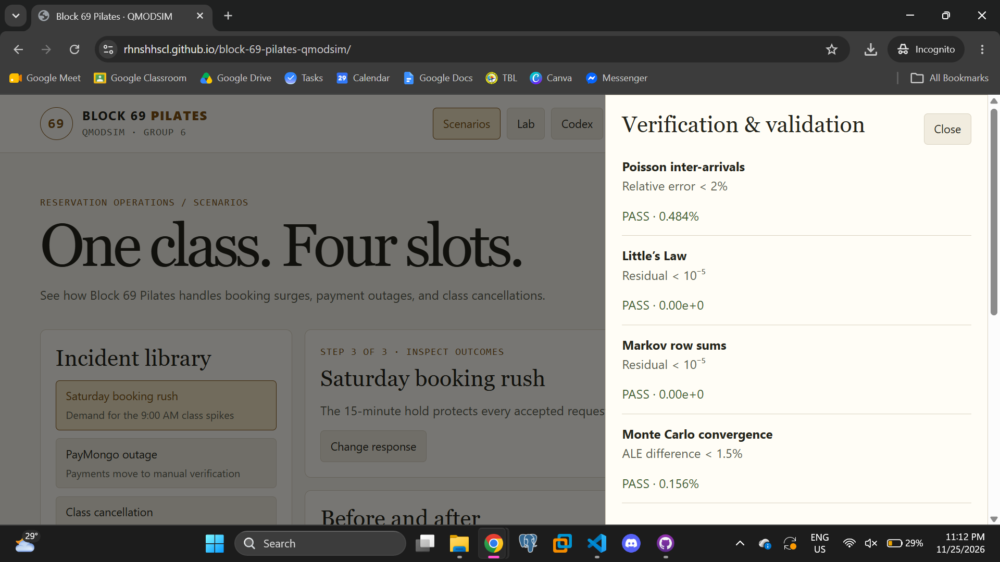

# Mathematical Verification

The GitHub Pages simulator passed all four checks in the
Verification & Validation drawer using the default settings.

| Check | Observed result | Status |
| --- | --- | --- |
| Poisson inter-arrivals | 0.484% relative error | PASS |
| Little’s Law | 0 residual | PASS |
| Markov row sums | 0 residual | PASS |
| Monte Carlo convergence | 0.156% difference in annual loss estimates | PASS |

[Test script](verify.mjs)